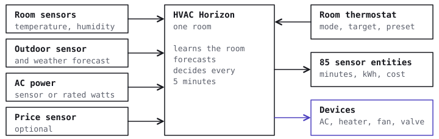

<!-- Generated by jupiter-docs from docs-src/index.md. Do not edit; change the source and run jupiter-docs build. -->

# HVAC Horizon

## What it does

HVAC Horizon controls the climate of one room in Home Assistant. You give it an air conditioner or a heater, room temperature sensors and an outdoor temperature sensor. It adds one thermostat for the room and 85 sensors.

- It learns how fast the room gains heat and how fast the AC cools it, from readings it takes every 5 minutes.
- It forecasts the minutes, the energy and the cost for the room to reach its target.
- With control on, it drives the AC, a heater, and any second AC, fan, valve, cover or window actuator you add.

<picture><source media="(prefers-color-scheme: dark)" srcset="diagrams/overview-dark.svg"></picture>

A new entry starts in observe-only mode. [Architecture](develop/architecture.md) has a diagram of every part. It learns and forecasts, and it sends no commands until you turn control on.

## Who it is for

HVAC Horizon fits one room with an AC, a heater on a switch, or both.

- **An AC with a power sensor** gives the full room model: the forecast of time, energy and cost comes from the measured power.
- **An AC with no power sensor** works with its rated power. The AC counts as drawing it while it reports that it runs, so the energy and the cost are estimates.
- **A room with heating only** has the modes `off` and `heat`. It learns the heater's rate and forecasts the heat-up time.

It does not fit a house you want on one thermostat. Each entry is one room.

AC cooling has run on one real installation. Every other device type has run in tests and in a simulated room only: see [What has run on real devices](concepts/limits.md#what-has-run-on-real-devices).

## Where to start

| You want to | Read |
| :--- | :--- |
| Install it and add a room | [Install](start/install.md) |
| Choose the mode, the target and the preset | [Use the room thermostat](guides/use-the-room-thermostat.md) |
| Add a heater, a price sensor or other devices | [Set up the integration](guides/set-up-the-integration.md) |
| Understand a forecast or a status | [Read the forecast](guides/read-the-forecast.md) |
| Find out why a device is on or off | [Troubleshoot](guides/troubleshoot.md) |
| Look up one setting or sensor | [Settings](reference/settings.md), [Sensors](reference/sensors.md) |

## Requirements

- Home Assistant 2026.11.2 or later.
- A `climate` entity for the AC, with the modes `off` and `cool`, or a `switch` for a heater.
- For an AC: a power sensor in watts that reads the whole unit, or its rated power. A wall plug with power metering works.
- At least one room temperature sensor and one outdoor temperature sensor.
