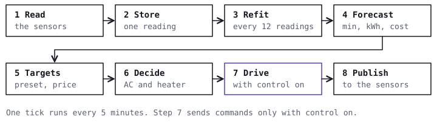

<!-- Generated by jupiter-docs from docs-src/concepts/design.md. Do not edit; change the source and run jupiter-docs build. -->

# How it works

## One entry, one room

An entry models one room. Every 5 minutes it runs one tick: read the sensors, store a reading, refit the model when due, forecast, plan the targets and drive the devices. The tick is `HorizonCoordinator._async_update_data()`. See [Architecture](../develop/architecture.md).

<p align="center"><picture><source media="(prefers-color-scheme: dark)" srcset="../diagrams/tick-dark.svg"></picture></p>

## Room model

One equation describes the room:

**Room model**

```text
dT/dt = k (T_out - T) - c P + g
```

| Symbol | Unit | Meaning |
| :--- | :--- | :--- |
| `T`, `T_out` | °C | Room temperature (median of the room sensors) and outdoor temperature |
| `P` | kW | Electrical power of the AC. Below 0.2 kW counts as off. |
| `k` | 1/h | Heat gain toward outdoors |
| `c` | K/h per kW | Cooling effect of the AC |
| `g` | K/h | Constant gain from people and appliances |

`fit()` in `model.py` solves `k`, `c` and `g` by least squares over consecutive readings.

- It drops outliers: residuals beyond 3.5 median absolute deviations, at most 10 % of the readings.
- It rejects a fit whose normal matrix has a condition number above 1000.
- It returns a standard error for each value. The error of `c` gives the low and high minutes and the confidence label.
- `k` and `c` stay at or above zero. When the plain fit gives a negative `k` or `c`, the fit tries `k` at zero, `c` at zero and both at zero, and uses the one with the smallest squared error.

Readings where the AC heats, dries or runs its fan only are left out. Intervals with the heater on are left out of the passive drift. A reading is not stored while the outdoor sensor is stalled.

A room with no AC has no `c`. `learn_passive_rates()` in `tpi.py` fits `k` and `g` from the intervals with the heater off, and the heating model below adds the heater's rate.

The fit uses the readings of the last 14 days when they alone give a fit, and all 30 days otherwise. The `fit_window_days` sensor shows which.

## Models kept through an idle season

The store holds 30 days of readings. An AC or heater that stays off for longer leaves no reading to fit its model from. Each refit therefore stores the last good value of six models: the room fit, the room rates, the heater rate, the AC heating rate, the drying rate and the corrections. Each is stored with the time of the newest reading behind it. When a refit finds too few readings for a model, the stored value serves. The forecast, the price plan and preheat keep running on it.

The `kept_models` sensor lists each model in use that comes from the store, with its age in days. A new fit replaces the kept value as soon as the readings give one: 3 hours of AC on and off time over 3 runs for cooling, 12 intervals for heating or drying. A kept model describes the room of the season it was learned in, so expect a larger forecast error until the new fit arrives. `reset_learning` clears the kept models.

## Corrections

`corrections.py` fits three terms on what the room model leaves unexplained.

```text
g_eff = g + s S
c_eff = c + c_out (T_out - 30) + c_rh (RH - 50)
```

| Term | Needs | Meaning |
| :--- | :--- | :--- |
| `s` | `window_area_m2` | Extra gain per kW of solar gain `S` on the window |
| `c_out` | nothing extra | Change of `c` per K of outdoor temperature above 30 °C |
| `c_rh` | `room_humidity` | Change of `c` per percent of room humidity above 50 % |

A term is kept when it has the sign physics gives it (`s` above zero, `c_out` and `c_rh` below zero) and lowers the error on the newest 30 % of the readings by 3 %. A term needs 144 readings that carry it. The cooling forecast applies the kept terms at each minute: the solar gain follows the clear-sky model scaled to the current reading. The `fit_corrections` sensor lists the kept terms.

## Heating and drying

`mode_models.py` holds one model for each.

```text
heating:  dT/dt = k (T_out - T) + g + h
drying:   dRH/dt = -r
```

| Value | Source |
| :--- | :--- |
| `h` for a heater switch | The learned rise per hour at full output, from intervals with the heater on and the AC off |
| `h` for the AC in heat mode | `c_heat P`: the rise per kW from heat-mode intervals, times the mean power of those intervals |
| `r` | The mean fall of room humidity per hour over dry-mode intervals |

Each needs 12 intervals. The forecast sensors show the heating forecast while the mode heats and the room is below the heat target, and the drying forecast in dry mode. See [Heating and drying](../guides/read-the-forecast.md#heating-and-drying).

## Forecast

`forecast()` in `forecast.py` steps the model forward one minute at a time with the exact exponential solution of the equation. It returns minutes, energy and cost, or `unreachable` when the room does not reach the target in 12 hours.

- The AC runs at its learned running power for the whole forecast.
- The outdoor temperature follows the hourly weather forecast when a weather entity is set. `outdoor.py` builds the series: it starts at the sensor reading, and the offset to the forecast fades over 3 hours. A learned bias for each hour of the day is added once 6 sensor and forecast pairs exist.
- The cost uses the price slots of the price sensor. A minute with no slot has no cost.

## Targets

`_plan_control()` sets three values on each tick.

| Value | Meaning |
| :--- | :--- |
| Cool threshold | The AC cools when the room is above it. |
| Heat target | The heater aims at it. |
| Heat threshold | The heat target minus 0.5 K. The PID heater and AC heat start below it. |

The preset, your target, the price shift, occupancy, vacation and the mould bump set the cool threshold. The heat target follows the preset and never exceeds the cool threshold.

## Cooling decision

`decide()` in `decide.py` returns one action for the AC. Its order is:

1. A window open longer than its delay: off. In `auto`, with a window actuator or a whole-house fan, outdoors below 16 °C: off, until free cooling has failed for 30 minutes. `cool` mode has no outdoor limit. In `auto` the AC also waits 60 minutes after the heater ran, unless the room is 2 K above the cool threshold.
2. A night pre-cool, when `night_plan_act` is on.
3. An unoccupied room: pre-cool when a schedule event is near, else cool only above the setback.
4. An occupied room: cool above the threshold.

A running AC keeps cooling until the room is at the threshold. An AC that is off starts once the room is 0.5 K above it.

The coordinator then applies the rules that sit above `decide()`: the room thermostat's mode (in `fan_only` the AC runs its fan and never cools), off from the thermostat, free cooling, the night hold and the cooling plan. Free cooling comes first: while the entry holds the window open or runs the whole-house fan, the AC stays off.

### Setpoint regulation

Many ACs regulate on their own return-air sensor, which can read cooler than the room. HVAC Horizon lowers the setpoint it sends by the gap between the room median and the AC's `current_temperature`. An AC that reports no temperature is regulated from power: after 10 minutes in cool mode under 0.2 kW with the room above the threshold, the setpoint moves down one step per tick.

## Heating

A heater switch runs as a share of a 10 minute window. `pid.py` or `tpi.py` gives the share.

- PID stops 0.5 K below the heat target.
- TPI heats up to the heat target, and up to its thresholds above the target when both are set.

The heater stays off in each of these cases:

- The thermostat's mode does not heat.
- Outdoors is above 22 °C and the mode is `auto` or `dry`. `heat` mode has no outdoor limit.
- A window is open, the house is away or the lock is on.
- A sensor is stalled.
- The AC cools.

## Several devices in one room

With `fleet` set, `choose_devices()` in `fleet.py` picks the devices for the gap to the target. `fast` orders them by effect, `economy` by cost per kelvin. Each device has its own rate in K per hour per kW. The rate you enter is replaced by a fitted rate once the device has run alone for 6 readings. A device with no power sensor counts its rated watts while it runs.

## Safety rules

These hold on every tick, above every other decision.

- Off from the room thermostat goes to every device at once. A stop is never delayed.
- No start command goes out before the first valid room and outdoor readings.
- A room held off sends no start, including after a restart.
- A start after a stop waits for the restart delay. The delay counts from the device's own last change.
- A stalled sensor turns the AC off and sets the heater to 0.
- Unloading the entry turns off every output the entry commanded.

## Storage

The entry stores its readings, the room model, the kept models, the thermostat's mode, targets and humidity target, the lock, the house mode and the commanded device states with Home Assistant's `Store`, version 4. `_HorizonStore` in `coordinator_common.py` migrates older versions.

## Terms

- <a id="term-cool-threshold"></a>**cool threshold**: The room temperature above which the AC cools. It comes from the preset, your target, the price and occupancy.
- <a id="term-heat-target"></a>**heat target**: The room temperature the heater aims at.
- <a id="term-heat-threshold"></a>**heat threshold**: The heat target minus 0.5 K. A PID heater and AC heat start below it.
- <a id="term-observe-only"></a>**observe only**: The state of an entry with control off. It learns and forecasts and sends no commands.
- <a id="term-preset"></a>**preset**: One of comfort, eco, boost and away. Each has its own cool threshold and heat target.
- <a id="term-restart-delay"></a>**restart delay**: The time a device stays off before it may start again, 3 minutes by default.
- <a id="term-room-model"></a>**room model**: The three learned values k, c and g that describe how the room gains heat and how the AC cools it.
- <a id="term-tick"></a>**tick**: One run of the control loop. It happens every 5 minutes and after each change on the room thermostat.

**See also**

- [Limits of the model](limits.md): what the model assumes and leaves out.
- [Architecture](../develop/architecture.md): the modules and the order of the tick.
