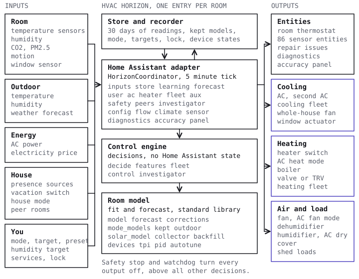

<!-- Generated by jupiter-docs from docs-src/develop/architecture.md. Do not edit; change the source and run jupiter-docs build. -->

# Architecture

## Layout

<picture><source media="(prefers-color-scheme: dark)" srcset="../diagrams/system-dark.svg"></picture>

The code is in `custom_components/hvac_horizon/` and has three layers.

| Layer | Where | Modules | May import |
| :--- | :--- | :--- | :--- |
| Room model | `room_model/` | `model.py`, `forecast.py`, `corrections.py`, `mode_models.py`, `kept.py`, `outdoor.py`, `solar_model.py`, `collector.py`, `backfill.py`, `devices.py`, `tpi.py`, `pid.py`, `autotune.py` | The standard library and `room_model` |
| Control engine | `engine/` | `decide.py`, `features.py`, `fleet.py`, `control.py`, `investigator.py` | `room_model`, `engine` and `const.py` |
| Home Assistant adapter | the package root | `coordinator.py` and the `coordinator_*.py` mixins, `__init__.py`, `config_flow.py`, `climate.py`, `sensor.py`, `diagnostics.py`, `accuracy_api.py` | Anything |

The first two layers hold no Home Assistant state: functions take values and return values. `tests/test_layers.py` reads the imports of every module in `room_model/` and `engine/` and fails on one outside its column.

Both packages sit inside the integration folder, because HACS installs that folder only. Python runs the integration's `__init__.py` before a module below it, so importing `room_model` on its own needs the package copied out of the folder.

## Pure modules

| Module | Job |
| :--- | :--- |
| `collector.py` | `Entry`, one reading. Sample history, running power, the cycle check and CSV export. |
| `model.py` | `fit()` learns `k`, `c` and `g` with standard errors. `fit_confidence()` labels the fit. |
| `forecast.py` | `forecast()` gives minutes, energy and cost to a target. `price_at()` reads the price slots. |
| `corrections.py` | `learn_corrections()` fits the sun, outdoor temperature and humidity terms. `apply()` gives the fit at given conditions. |
| `mode_models.py` | The heating and drying models and their forecasts. |
| `kept.py` | The last good value of each learned model, to and from the store. |
| `outdoor.py` | The outdoor temperature series from the hourly forecast, the night low and the sensor-to-forecast bias. |
| `decide.py` | `decide()` returns one AC action. `cool_above_c()` gives the cool threshold. |
| `features.py` | Decision functions: presets, stall rule, inhibit, lock, restart delay, PWM, price shift, valve, shed, humidity, free cooling. |
| `fleet.py` | `choose_devices()` picks the heaters and coolers for a gap. `calibrate_rates()` fits each device's rate. |
| `tpi.py` | `learn_room_rates()`, the online gains and `tpi_on_percent()`. |
| `pid.py` | `Pid`, the heater PID controller. |
| `control.py` | `precool_start_in_min()` picks the cheapest start that meets a deadline. |
| `devices.py` | The room model with one coefficient per device, for two ACs. |
| `backfill.py` | `backtest()` replays past cool-downs. |
| `autotune.py` | `RelayTuner`, the relay test and its PID gains. |
| `solar_model.py` | Sun position and irradiance on a vertical window. |
| `investigator.py` | `investigate()` gives the rule-based answer. `CallBudget` limits model calls per day. |

## Coordinator

`HorizonCoordinator` in `coordinator.py` is a `DataUpdateCoordinator` with a 300 second interval. It holds `__init__`, the tick and `_plan_control`. It inherits one mixin per area.

| Module | Mixin | Job |
| :--- | :--- | :--- |
| `coordinator_inputs.py` | `InputsMixin` | Reads the room and optional sensors. Stall detection, occupancy, window advice. |
| `coordinator_store.py` | `StoreMixin` | The stored payload, the commanded-state record, recorder backfill. |
| `coordinator_learning.py` | `LearningMixin` | Model and fleet refits, online gains, the gain suggestion. |
| `coordinator_forecast.py` | `ForecastMixin` | Weather, solar and price inputs, the forecast, pre-cool and preheat timing. |
| `coordinator_user.py` | `UserMixin` | The thermostat's mode, targets, humidity target and presets, the lock, what-if and the relay test. |
| `coordinator_ac.py` | `AcMixin` | `_async_control`: the AC action, setpoint and mode writes, AC heat, dry mode, the second AC. |
| `coordinator_heater.py` | `HeaterMixin` | Heater gates, PWM windows, the heater switch and output limits. |
| `coordinator_fleet.py` | `FleetMixin` | Fleet choice and driving. |
| `coordinator_aux.py` | `AuxMixin` | Valve, load shedding, window actuator, free cooling, cover and fan mode. |
| `coordinator_safety.py` | `SafetyMixin` | The safety stop, the locked stop, the switch driver, `_send()` for every device command, the watchdog and the unconfirmed-command check. |
| `coordinator_peers.py` | `PeersMixin` | Requests between entries of one house. |
| `coordinator_investigator.py` | `InvestigatorMixin` | The mode-change explanation and the on-demand report. |
| `coordinator_common.py` | none | Helpers, constants, the logger and `_HorizonStore`. |

Each mixin lists the instance attributes it reads as class-level annotations. A test that patches a module-level function patches the module that calls it, for example `coordinator_learning` for `fit`.

## Home Assistant surface

| Module | Job |
| :--- | :--- |
| `__init__.py` | Registers the actions, sets up the coordinator and the platforms, runs the safety stop on unload. |
| `config_flow.py` | The setup and reconfigure flows. `_schema()` lists every key, selector and default. `SECTIONS` assigns each key to a form section. The two list settings, `schedule_blocks` and `fleet`, have their own steps with `_schedule_schema()` and `_fleet_schema()`. |
| `const.py` | Setting keys, defaults and limits. |
| `climate.py` | `HorizonClimate`, the room thermostat. It sets the mode, target and preset on the coordinator and never drives a device. |
| `sensor.py` | `STATUS_KEYS` and the sensor entities. |
| `diagnostics.py` | The diagnostics download, with entity IDs redacted. |
| `accuracy_api.py` | The JSON views and the sidebar panel. The panel is the web component in `frontend/accuracy-panel.js`, which calls the views through `hass.callApi`. |

## One tick

`_async_update_data()` runs these steps in order.

1. **Weather.** `_refresh_weather()` fetches the daily and hourly forecast, at most every 30 minutes.
2. **Read and store.** `_read_inputs(now)` builds an `Entry`. The tick appends it and caps the history at `MAX_ENTRIES`.
3. **Refit.** Every 12 readings, `_refit()` runs `learn_room_rates()`, `fit()` and `backtest()`.
4. **Forecast.** `_forecast(now)` sets `minutes`, `energy_kwh`, `cost`, `status` and the fit attributes.
5. **Context.** The tick sets the day type, night plan, occupancy, solar gain, window advice, the economizer phase, the heat source and the motion preset.
6. **Window actuator.** `_drive_window_actuator(result)` opens or closes the actuator.
7. **Targets.** `_plan_control(now, result)` sets the preset, the cool threshold, the heat target and the heat threshold.
8. **Plans.** `mpc_plan()` and `mpc_heat_plan()` run when a fit and price slots exist.
9. **Heater output.** PID or TPI gives the output. `_heater_gate_closed(result)` sets the gate.
10. **Cover and load shedding.** `_drive_cover()` and `_drive_shed()`.
11. **AC control.** `_async_control(now, result)` runs with control on. It handles off from the thermostat, the lock, the manual-change pause, the stall, free cooling and the mode, then calls `decide()` and writes the AC. It also drives the fan, humidifier, dehumidifier, boiler and whole-house fan.
12. **Heater switch.** `_async_heater_step(now, result)` runs in a `finally` block, so it runs when the AC step raises.
13. **Investigation and valve.** `_publish_investigation()` and `_drive_valve()`.
14. **Publish.** The result dict becomes `coordinator.data`. The sensors and the thermostat read it.

The room thermostat calls `async_refresh()` after each change, so a new mode or target takes effect at once.

## Watchdog

`start_watchdog()` in `coordinator_safety.py` starts a 60-second timer at setup. It reads `_last_tick_done_s`, which the tick sets when it returns without an error. When no tick has finished for 16 minutes, the first check runs one tick itself, unless a tick is running. After a clock jump or a suspend that tick finishes and nothing trips. When it fails or a tick hangs, the next check turns every output off.

## Free cooling states

`free_cooling_step()` in `features.py` is the only code that changes the free cooling phase.

| From | To | When |
| :--- | :--- | :--- |
| `idle` | `running` | The window this entry opened is open, or the whole-house fan runs. |
| `running` | `idle` | Neither is the case. |
| `running` | `gave_up` | The room is 2 K above the cool threshold after 30 minutes, or above it and fell by less than 0.3 K in 30 minutes. |
| `gave_up` | `idle` or `running` | The room is at or below the cool threshold. |

While the phase is `gave_up` the window closes, the fan stops and the AC cools.

## Add a setting

1. Add the key and its default to `const.py`.
2. Add it to `_schema()` and to one section of `SECTIONS` in `config_flow.py`, and its label to `translations/en.json`.
3. Read it in the coordinator and make it change a device command or a published value.
4. Add a row to `SETTINGS` in `tests/ha/test_settings_effect.py` with the level you expect: `control` or `published`.
5. Add it to [Settings](../reference/settings.md).

`test_every_setting_in_const_has_an_audit_row` fails when step 4 is missing. The row's test fails when the setting changes nothing. See [Guard tests](test-and-release.md#guard-tests).

## Add a published value

Write the key to the result dict in the mixin that computes it. Add it to `STATUS_KEYS` in `sensor.py`, or return it from `extra_state_attributes`. `tests/test_published_keys.py` fails when a key has neither.

**See also**

- [Test and release](test-and-release.md): the tests and the release steps.
- [How it works](../concepts/design.md): the room model and the control decision.
