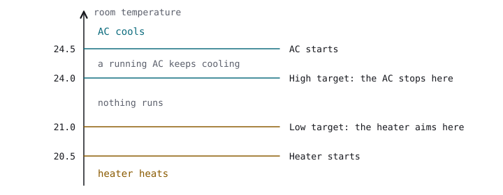

<!-- Generated by jupiter-docs from docs-src/guides/use-the-room-thermostat.md. Do not edit; change the source and run jupiter-docs build. -->

# Use the room thermostat

## The room thermostat

Each entry has one `climate` entity named `HVAC Horizon <AC name>`. Use it as the thermostat of the room. Leave the AC's own climate entity alone: HVAC Horizon sets its mode and setpoint.

The thermostat needs control on. With control off it reads `off` and its `control` attribute reads `observe only`. See [Turn on control](../start/install.md#turn-on-control).

## Modes

The mode decides which devices may run. A device starts only when the room needs it.

| Mode | Cooling devices | Heating devices |
| :--- | :--- | :--- |
| `auto` | Run above the cool threshold | Run below the heat threshold |
| `cool` | Run above the cool threshold | Stay off |
| `heat` | Stay off | Run below the heat threshold |
| `dry` | The AC runs in its dry mode and does not cool | Run below the heat threshold |
| `fan_only` | The AC runs its fan and does not cool | Stay off |
| `off` | Stay off | Stay off |

`auto` is the default. The thermostat lists `heat` when the entry can heat: a heater switch, `ac_heat`, `mpc_heat_plan` or a heating fleet device. It lists `dry` when the AC has a dry mode or the entry has a dehumidifier switch. It lists `fan_only` when the first AC has that mode and the room has no fleet devices.

Cooling devices are the AC, the second AC, cooling fleet devices, the whole-house fan and the window actuator. Heating devices are the heater switch, the AC in heat mode, the boiler, the valve and heating fleet devices.

The mode is stored. It is the same after a restart.

### Off

`off` sends off to every device of the entry in the same call. No minimum run time delays it. Nothing starts while the room is off, including after a restart of Home Assistant.

To leave `off`, choose a mode. The `climate.turn_on` service returns to the mode you had before `off`.

### Dry

In `dry` the AC runs in its own dry mode.

- With a room humidity sensor, the AC dries while the room is above the humidity target (60 % by default) and goes off 3 points below it.
- With no room humidity sensor, the AC dries until you change the mode.
- An entry with a dehumidifier switch runs that switch and leaves the AC off.

Drying cools the room. The heater may run at the same time to hold the heat target. In `dry` the heater obeys the outdoor heating limit, so it stays off when outdoors is above 22 °C. When the room falls 1 K below the heat threshold, the AC pauses. It dries again once the room is back at the threshold.

### Fan

In `fan_only` the first AC runs in its own fan mode. Nothing cools and nothing heats, at any room temperature. The fan starts with no restart delay, because no compressor starts. A stalled room sensor turns the AC off.

## Restart delay

A start after a stop waits for the restart delay, 3 minutes by default. The thermostat shows the wait in its `pending` attribute:

**Attribute pending**

```text
start in 3 min: restart delay
```

The device starts by itself when the delay ends. Set the delay with `min_off_min` in the **Expert tuning** section. 0 turns it off.

## Outdoor limits

An entry with a window actuator or a whole-house fan cools with outdoor air first. In `auto` its AC stays off while outdoors is below 16 °C. The limit ends when the open window or the fan has left the room 2 K above the cool threshold for 30 minutes, or cooled it by less than 0.3 K in 30 minutes. An entry with neither has no outdoor cooling limit. `cool` has no outdoor limit: the AC cools whenever the room is above the cool threshold.

In `auto` the AC does not cool while the heater runs or within 60 minutes of its last run. A room 2 K above the cool threshold cools at once. This stops the heater and the AC from taking turns.

In `auto` and `dry` the heater stays off while outdoors is above 22 °C. `heat` has no outdoor limit: the heater runs whenever the room is below the heat threshold.

When the room is below the heat threshold and a gate holds the heater off, `pending` names the gate:

| `pending` | Cause |
| :--- | :--- |
| `heat held: outdoors above 22 °C` | The mode is `auto` or `dry` and outdoors is above 22 °C. |
| `heat held: window open` | The window sensor reads open. |
| `heat held: house mode is away` | The house mode is `away`. |
| `heat held: another room is cooling` | Another entry of the same house cools. |
| `heat held: locked` | The lock is on. |
| `heat held: a sensor has stalled` | A room or outdoor sensor has stopped reporting. |

## Target temperature

The target is the comfort temperature, 16 to 32 °C in steps of 0.5. Setting it stores your value, and HVAC Horizon keeps it across restarts.

A target you set applies at once. The room returns to the `comfort` preset: a timed preset ends, and a schedule block with another preset is set aside until the schedule moves to its next block. Two states still override it: the vacation switch, and an away house or an empty room.

The thermostat shows the target you set, with these exceptions:

- A preset other than `comfort` shows its own setpoint.
- While the vacation switch is on, it shows `vacation_c`.
- In `heat` mode it shows the heat target. In `cool`, `dry`, `fan_only` and `off` it shows the cool target.
- In `auto`, a room that can heat shows two targets. See below.

The threshold the AC cools above can sit above the cool target. A high price raises it by up to 1 K, and the comfort-versus-energy weight and the mould bump raise it too. A low price does not lower it. The Cool above sensor shows the threshold. See [Services and presets](services-and-presets.md).

The AC cools when the room is above the cool threshold. The heater heats when the room is 0.5 K or more below the heat target. The sensors Cool above and Heat below show both values.

<p align="center"><picture><source media="(prefers-color-scheme: dark)" srcset="../diagrams/thresholds-dark.svg"></picture></p>

## Low and high target in auto

In `auto`, a room that can heat shows a low and a high target. The room heats to the low target and cools above the high one. Set both on the card, or with `climate.set_temperature` and `target_temp_low` and `target_temp_high`. The low target must not be above the high target.

Setting one temperature, in any mode, sets both targets to it. `cool` mode shows the high target and `heat` mode the low one.

## Fan mode, swing mode and humidity

The card lists the fan modes and swing modes of the first AC, when the AC has them. A change goes to that AC at once. With `auto_fan` on, the integration sets the fan mode again on its next tick.

With a room humidity sensor set, the card shows the room humidity.

## Humidity target

The card has a humidity target when the entry has a room humidity sensor and a device that dries: a dehumidifier switch or an AC with a dry mode. Set it on the card or with `climate.set_humidity`. The range is 35 to 75 % and the default is 60 %. The target is stored.

| Device | When it runs |
| :--- | :--- |
| Dehumidifier switch | Above the target, in every mode. Off 3 points below it. |
| AC dry mode | Above the target, in `dry` mode or with `dry_for_humidity` on. Off 3 points below it. |
| Humidifier switch | Below 40 %, or below the target minus 20 when the target is under 60 %. |

## Presets

| Preset | Cools above | Heats to |
| :--- | :--- | :--- |
| `comfort` | Your target | Your target |
| `eco` | `eco_c`, or your target when unset | `heat_eco_c`, or your target minus 1 |
| `boost` | `boost_c` (23 °C) | `heat_boost_c`, or your target plus 1 |
| `away` | `away_c` (27 °C) | 16 °C |

A preset you choose holds until the schedule moves to another block. It is not kept across a restart. See [Services and presets](services-and-presets.md) for schedule blocks and timed presets.

## Action

The `hvac_action` attribute shows what the devices do now.

| Action | Meaning |
| :--- | :--- |
| `cooling` | The AC is in cool mode and draws 0.2 kW or more, or a cooling fleet device runs |
| `heating` | The heater switch is on, the AC heats, or a heating fleet device runs |
| `drying` | The AC is in dry mode and draws 0.2 kW or more, or the dehumidifier runs in `dry` mode |
| `fan` | The AC is in its fan mode and nothing heats or cools |
| `idle` | Nothing runs, or the AC is in cool, heat or dry mode and draws under 0.2 kW |
| `off` | The room is held off |

The action follows the devices as they change. The mode is your choice and does not change when a device starts or stops.

## Errors

| Message | Cause | Fix |
| :--- | :--- | :--- |
| `HVAC Horizon entry is locked` | The lock is on, so the target, the preset and the mode cannot change. | Unlock with `hvac_horizon.set_lock`. See \[\[guides/services-and-presets#lock-and-pin |

**See also**

- [Services and presets](services-and-presets.md): presets by schedule, timed presets and the services.
- [Troubleshoot](troubleshoot.md): why a device is on or off.
